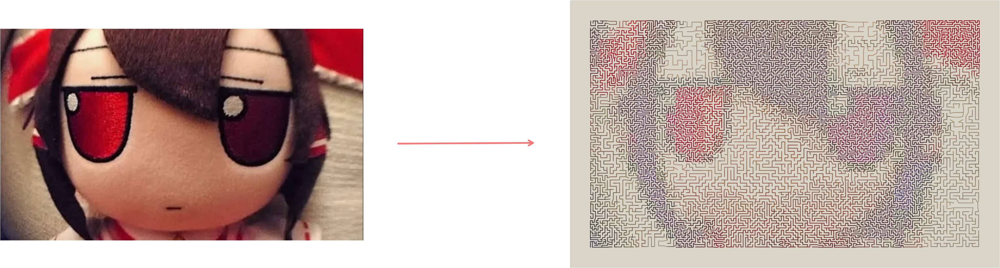

# Mazify

Turn any image into a detailed, printable maze.

**[Try mazify](https://ctx-o1.github.io/mazify/)**



Mazify samples the image into a brightness grid. Each sampled region becomes a variable-resolution graph: darker areas contain more nodes, while lighter areas contain fewer.


- Generate mazes from any browser-supported image
- Preserve image details using adaptive maze density
- Adjust grid size, detail, and contrast
- Invert light and dark regions
- Render with source-image colors
- Reveal the underlying structure and solution
- Generate alternate maze layouts from the same image
- Copy or export a high-resolution PNG


## Running locally

```bash
git clone https://github.com/ctx-o1/mazify.git
cd mazify
npm install
npm run dev
```

## Animations

Image morph is the default animation. Stage wipe is also available through
`?animation=wipe`. Open `animations.html` to compare them with the same image,
generation settings, and seed.

The two versions have different line weights and colour treatments as well as
different transitions. Their settings, keyframes, and rendering differences are
documented in [Animation variants](docs/animations.md).


## References

This maze generation method is based on H. Hernán Moraldo's [Method for generating mazes from images](https://web.archive.org/web/20260307222210/http://www.hernan.moraldo.com.ar/mazegeneration.htm), first published in 2009.


## License

[MIT License](LICENSE)
